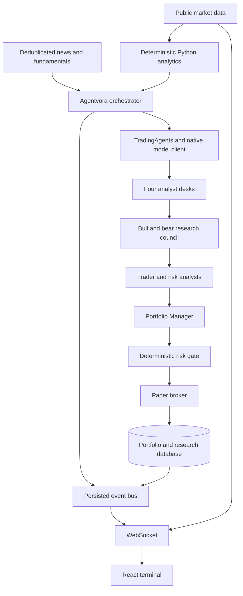

# Architecture

## Processes and boundaries

Run one FastAPI/Uvicorn process. It owns the APScheduler interval, bounded analysis queue, per-asset leases, worker semaphore implicit in worker count, event bus, price streams and accounting lock. Multiple API workers or replicas are unsupported: local stream delivery and startup interruption recovery require a single owner. PostgreSQL row locks and database unique constraints provide additional ledger protection, but do not turn this into a distributed scheduler.

React 19/Vite/Tailwind 4 renders a public landing route and a lazily loaded research workspace. TanStack Query deduplicates requests and caches snapshots. Daily historical candles are drawn with Lightweight Charts. Current quote updates are sent independently, with timestamps; matching-day candles update incrementally. Indicators refresh from server snapshots, never from model arithmetic. The browser never receives provider configuration. Operator authentication uses a separate optional local/required production token, held only in tab memory.

## Lifecycle

1. Normalize against the explicit 300-asset catalog (250 stocks and 50 cryptocurrencies). Reject unrecognized or ambiguous symbols.
2. Check agent configuration, rate limit, asset lease and persisted cooldown. Insert queued AgentRun and Lease atomically.
3. Worker fetches a cached or fresh market snapshot. Deterministic indicators are computed once per snapshot. News and fundamentals load concurrently, with missing information explicit.
4. Four bounded snapshot-fed analysts run in a LangGraph state graph. Upstream TradingAgents factories handle bull, bear, research management, trader, three risk analysts and portfolio management. Each node emits `agent.started` immediately before execution, reports after completion and errors on failure. No hidden message/token streams are forwarded.
5. A bounded structured extraction produces BUY/SELL/HOLD, advisory evidence confidence, requested allocation and summary. The extracted action must agree with the upstream final rating. Any missing required report, invalid schema or disagreement fails the run closed.
6. Fetch an execution quote independently. The broker checks freshness, confidence, position/invested/cash limits, cycle limit and daily loss. SELL closes an existing long; no position means rejection. HOLD is recorded without a fill.
7. Under the accounting lock, write Decision, Order, Fill, Position and PortfolioSnapshot in one transaction. Unique decision/run/order references prevent replay. Publish decision, execution and portfolio events after commit.
8. Clear the lease. Errors retain the run and reports, and produce no trade. Restart marks interrupted work; it does not replay a partially completed run or an existing order.

## Storage

SQLAlchemy 2, SQLite locally and `postgresql+psycopg` in production. Alembic revision `0001` creates the initial schema; revision `0002` consolidates the latest-snapshot cache and makes its symbol index unique. UTC ISO timestamps and UUID keys throughout. Account cash, position quantity, entry basis and realized P&L use fixed-precision Numeric columns and Decimal calculations.

Asset and the latest MarketSnapshot are each unique by canonical symbol. Snapshot refresh updates that existing cache row; each new analysis freezes its input snapshot in AgentRun for audit rather than appending duplicate cache rows. Asset/MarketSnapshot track source context; AgentRun owns AgentReport, AgentEvent and Usage. A run has at most one Decision; a decision has at most one Order; a filled order has at most one Fill. Position is unique by symbol; PortfolioSnapshot records NAV. NewsItem deduplicates URL. Lease prevents duplicate asset work. PerformanceMetric is reserved for persisted aggregate reports; current performance is calculated from actual fills and NAV observations.

Buy fees are capitalized into cost basis. Sell fees reduce proceeds. Quantity supports fractional assets. Configurable adverse slippage and fee basis points apply to both sides. Uninvested cash starts at $100,000, with no fabricated prior trades. Portfolio marks run every minute using available quotes; unavailable marks retain their last timestamp. Daily Sharpe requires at least 30 daily returns. API lists are bounded for UI use; performance aggregation uses the complete ledger.

## Cost and data integrity

Default 30-minute per-asset cooldown, two concurrent workers, one debate round, one risk round, 2048 output-token cap, shared 7000-token/minute request reservation, low reasoning effort, 90-second request timeouts, bounded six-article context and no startup analysis. Enabling bootstrap queues only two assets. Price streams do not trigger model calls. Scheduled cycles analyze the configured list and allow at most three fills per cycle. Technical calculations are deterministic. No backtest interface is exposed; runs are explicitly PAPER and current-time only. Vendor code retains its own point-in-time functionality.

Important events are persisted before fan-out. Queues are bounded at 500 per subscriber, feed history at 150 in the UI; reconnect reloads persisted events. High-frequency ticks are transient. A dropped transient tick is recoverable through REST polling. This is a research terminal, not a tick-complete market archive.
